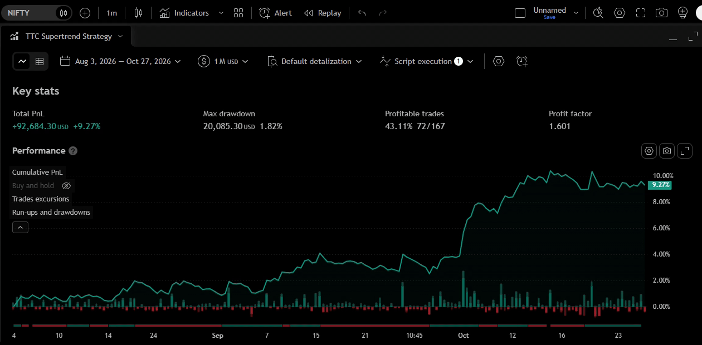

# TTC Optimiser

## What Is the TTC Optimiser?

The **TTC Optimiser** is a powerful tool designed to help traders identify the most suitable input parameters for the TTC strategy. It backtests **1,600 unique parameter combinations** and determines the best-performing settings based on the selected optimisation criteria.

The effectiveness of technical indicators can vary significantly depending on the trading symbol and timeframe. Consequently, finding a set of strategy parameters that delivers consistent performance across different market conditions can be challenging.

The TTC Optimiser simplifies this process by systematically evaluating all 1,600 parameter combinations and comparing their backtest results to identify the optimal settings for a specific symbol and timeframe — all within seconds.

## How to Use the TTC Optimiser

The TTC Optimiser identifies the best-performing parameters for the symbol and timeframe on which it is applied, based on your selected optimisation criteria.

### Steps

1. Add the **TTC Optimiser** to your chart.
2. Configure the optimisation settings according to your requirements.
3. Run the optimiser and note the best-performing parameters.
4. Enter the selected parameters into the **TTC Strategy**.
5. Review the strategy's backtest report to determine whether its performance meets your requirements.
6. If the results are satisfactory, consider using the strategy for further analysis or as part of your trading strategy.

### Video demonstration:
https://github.com/user-attachments/assets/647ed400-502b-4367-8cf3-b2564a9ee0e0

## TTC Optimiser Settings

The TTC Optimiser provides several settings that allow you to customise the optimisation process.

### 1. Parameter Range

Configure the range of TTC strategy parameters to be tested during optimisation. This allows you to control which parameter combinations are included in the analysis.

### 2. Optimisation Criteria

Choose the performance metric used to identify the best parameters, such as **Profit and Loss (PnL)** or **Accuracy**.

### 3. Result Filters

Apply filters to exclude parameter combinations that do not meet your specified criteria. Only the results satisfying the selected filters will be retained.

### 4. Commission Settings

Include trading commissions in the backtests to account for transaction costs when evaluating the performance of different parameter combinations.

For a detailed explanation of each setting, refer to the [Supertrend Optimiser Settings Guide](optimiser-settings-guide/optimiser-settings-guide.md).

## Performance Reports

The following reports present the backtesting results of the TTC strategy using the best-performing parameter combinations identified by the TTC optimiser, based on the available chart data for the NIFTY 50 Index across nine timeframes: 1-minute, 3-minute, 5-minute, 10-minute, 15-minute, 30-minute, 1-hour, 4-hour, and daily.

[Check the performance of strategy in NIFTY50 here!](performance-reports/NIFTY50-report.gif)

### Important Note on Backtesting

Due to TradingView's limitations, the optimiser can backtest parameter combinations only on the historical data available on the chart. Therefore, the top-performing parameters identified by the optimiser are based on the available chart data and may not be the best-performing parameters across the entire historical period.

## Disclaimer

The TTC Optimiser identifies the best-performing parameters based on historical backtest results. However, **past performance does not guarantee future results**. Market conditions can change, and parameters that performed well historically may not perform as expected in live trading.

Backtest results may also differ from actual trading results due to factors such as slippage, transaction costs, and execution conditions.

The TTC Optimiser and TTC Strategy are analytical tools and do not guarantee profitability. Use both scripts responsibly and at your own risk. Always conduct your own research and testing before making trading decisions.
